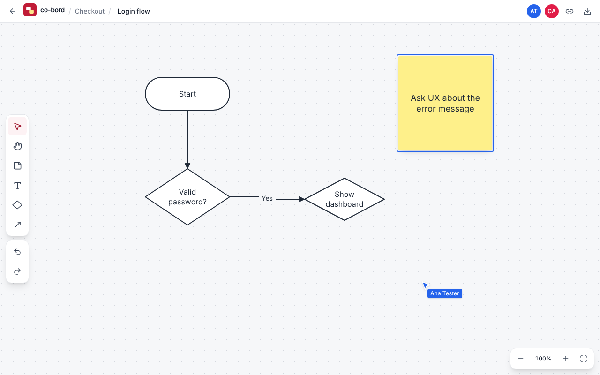

# co-bord

Collaborative boards for teams: flowcharts, design documents and retrospectives, with everyone's cursor and changes live on the same board.



## Features (0.6.0)

### Boards

-  **Infinite canvas**: pan with the Hand tool, by holding Space, with the middle button, the trackpad or one finger on touch screens; zoom with Ctrl + wheel, a pinch or the zoom controls. **Fit** (Shift 1) shows everything, Shift 2 the selection.
-  **Sticky notes, text and shapes**: flowchart shapes (process, rounded, ellipse, decision, start / end, input / output, preparation, document, database, triangle). Click to add one at its default size, or drag to draw it. Double-click the board to write text anywhere.
-  **Connectors**: drag from a shape's **+** handles, or use the Connector tool, from one element to another. They stay attached when elements move, and can be straight, elbow or curved, with arrows, dashes, color, width and a label. Drag a connector's end to attach it somewhere else.
-  **Editing**: select with a click, Shift + click or a selection box; move, resize (Shift keeps the proportions; sticky notes always do), change colors, text size, bold and alignment from the toolbar above the selection, bring to front or send to back, duplicate (Ctrl D), copy and paste (also between boards), delete, and move with the arrow keys.
-  **Undo and redo** (Ctrl Z, Ctrl Shift Z) undo your own changes only, never a teammate's.
-  **Download as PNG** of the whole board, with images and the first page of PDFs.

### Images, videos and PDFs

-  **Upload** images (PNG, JPEG, GIF, WebP, SVG), videos (MP4, WebM, Ogg, MOV) and PDFs from the media button, or **drop** or **paste** them on the board. Several files are laid out side by side; uploads show their progress.
-  **Embed links** from YouTube (including Shorts and a start time), Google Drive and Vimeo, or links to an image, a video or a PDF. Pasting such a link on the board embeds it too; other web links become a link card.
-  Every block is resized like any element (keeping its proportions from the corners) and can be connected to shapes.
-  **Videos play inside the board** and **PDFs page inside their block**: click a block to select it, then use its player or page buttons; drag it by its title bar. Playback and the PDF page are per person. The title bar opens the original in a new tab.
-  Google Drive files play for people who can open them in Google Drive. Uploaded files are visible only to the project's members.
-  Light, dark or system theme.

### Frames and templates

-  **Frames** (F, or drag with the Frame tool) are titled areas: moving a frame by its title moves everything inside it, nested frames included. Select several elements and click **Frame** to put them in one. Frames have light tints, can be renamed (Enter), and each one downloads as its own PNG. **Frames** next to the zoom controls lists them and jumps to one.
-  **Templates** add a ready-made layout next to what is on the board:
   -  Retrospectives: **Start, Stop, Continue**, **Mad, Sad, Glad** and **4Ls**, each with a column per topic and an action items area.
   -  **Workflow**: a connected flowchart with a start, steps, a decision and an end.
   -  **Design document**: context, goals, non-goals, proposal with a diagram area, alternatives, risks and a decision log, plus a column for review comments.

### Timer and voting

-  **Timer** shared by everyone on the board, from the timer button: 1, 3, 5 or 10 minutes or any length, with pause, +1 minute and stop. It chimes at zero.
-  **Voting**: choose the votes per person and start; everyone clicks items to vote (several times on one if they want) and clicks their badge to take a vote back. Each person only sees their own votes until the voting ends; then the totals show on the items, with a ranking that jumps to each one.
-  Viewers see the timer and the results; editors run them.

### Test coverage with SparkyTC

-  An admin connects a project to a SparkyTC project (2.2.0 or later) in the project's **Settings**, with a project API token created in SparkyTC (its **Settings**, **API tokens**). The token is stored encrypted and only reads.
-  Select a shape, sticky note, frame or media block and link it to the SparkyTC **test cases**, **suites or sections** and **test plans** that test it (the flask button in the toolbar above the selection).
-  Linked elements show a chip with the combined result of their tests in the current build: failed, blocked, not run, skipped or passed, worst first. Click it for each test's result, who ran it, and a link to it in SparkyTC.
-  **Coverage** (top right of the board) treats the shapes and sticky notes with text as the steps of a flow, in the whole board or one frame: the share of steps with linked tests, how they did in a build you choose, and every step in the order of the flow. Click a step to see it on the board, or download the report as CSV.
-  Results refresh every minute.

### Confluence

-  An admin connects a project to a Confluence Cloud space in the project's **Settings**: the site, an Atlassian account's email and API token (stored encrypted), the space key and, optionally, a parent page for new pages.
-  **Confluence pages on boards**: search a page by title in the media menu, or paste a page's address on the board. The card shows the page's title, space, last update and the start of its text, and opens the page.
-  **Publish** (top right of the board, or the button of a selected frame) creates a Confluence page from the whole board or one frame: its picture attached to the page, a link back to the board and, when the project is connected to SparkyTC, the test coverage report with a status per step. Publishing again updates the same page (a new version) unless you choose a new one.
-  The account needs permission to view and add pages and attachments in the space. Pages are published in its name, saying who published them.

### Notifications

-  The **bell** in the header lists what concerns you, checked every 30 seconds: **mentions** (`@username` in a sticky note, shape, text, label or frame title; typing `@` suggests the project's members) and changes to what you **follow**: a whole board (**Follow** in the board's header) or one item (the bell in the toolbar above a selection). Changes to the same thing are grouped while unread.
-  Clicking a notification opens the board on that item. **Mark all read** and **Clear read** keep the list short, and **Account** chooses which notifications you get.

### Guided retrospectives

-  **Group notes and summarize** (timer button, or **Summary** in the voting results) opens the retrospective panel for a retro made from a template (a frame with a frame per column).
-  **Group similar notes** puts the notes that share key words together in each column, under a heading, most voted first; columns grow and what's below them moves down. Undo reverts it in one step.
-  The **summary** comes from the board: notes and votes per column, the groups and the most voted notes, and the action items. With `ANTHROPIC_API_KEY` set, **Write with Claude** also drafts a summary with themes and suggested actions (the notes and votes are sent to Anthropic's API).
-  Copy the summary as text, **add it to the board** in its own frame, or **publish** it to Confluence with the retro's picture.

### Real time

-  Everyone on a board sees the others' changes as they happen, their cursors with their names, what each one has selected and who is typing where.
-  The avatars at the top show who is on the board; click one to go to their cursor.
-  If the connection drops, changes are kept and sent when it is back.

### Accounts and projects

-  **Own accounts**: on the first start co-bord asks for the admin account. Admins create the other accounts, reset passwords and create projects. Everyone changes their name and password in **Account**.
-  **Projects** hold boards and have members with a role: **Owner** (manages members, deletes boards), **Editor** (creates and edits boards) or **Viewer** (only looks). Projects a user is not in are hidden.

### Keyboard shortcuts

| Keys | Action |
| --- | --- |
| V, H, N, T, S / R, L, F | Select, Hand, Sticky note, Text, Shape / Rectangle, Connector, Frame |
| Enter | Edit the text, label or frame title of the selected element |
| Esc | Finish editing, clear the selection |
| Delete, Backspace | Delete |
| Ctrl A, Ctrl D | Select all, duplicate |
| Ctrl C, Ctrl X, Ctrl V | Copy, cut, paste |
| Ctrl Z, Ctrl Shift Z / Ctrl Y | Undo, redo |
| Ctrl +, Ctrl -, Ctrl 0 | Zoom in, out, 100% |
| Shift 1, Shift 2 | Fit everything, fit the selection |

## Roadmap

1. ~~Boards with shapes, sticky notes, text and connectors~~ (0.1.0)
2. ~~Live cursors, selections and changes~~ (0.1.0)
3. ~~Embedded images, videos (YouTube, Google Drive, Vimeo, uploaded) and PDFs as resizable blocks that play and page inside the board~~ (0.2.0)
4. ~~Templates: retrospectives (columns, votes, timer), workflows and design documents; frames~~ (0.3.0)
5. ~~Links to SparkyTC (test cases, suites and plans with their latest results, per-project token) and test coverage~~ (0.4.0); ~~Confluence pages embedded as blocks, and boards published to Confluence~~ (0.5.0)
6. Automations: ~~guided retrospectives and notifications~~ (0.6.0); card rules (for example, create a Jira issue when a note moves to a column) and generating SparkyTC test cases from a flow

## Running it

You need Docker with Docker Compose.

```bash
cp .env.example .env
```

Set `DB_PASSWORD` in `.env`, then:

```bash
docker compose up -d --build
```

co-bord is served on port 3200 (`APP_PORT`). Open it and create the admin account.

| Variable | Meaning |
| --- | --- |
| `DB_PASSWORD` | Password of the PostgreSQL user (required) |
| `APP_PORT` | Port on the host, 3200 by default |
| `COOKIE_SECURE` | `true` once co-bord is served over HTTPS |
| `SESSION_DAYS` | How long a sign-in lasts, 7 days by default |
| `MAX_UPLOAD_MB` | Largest file that can be uploaded, 500 MB by default |
| `ANTHROPIC_API_KEY` | Optional: lets Claude (Claude Opus 5.5) write retrospective summaries |
| `ENCRYPTION_KEY` | Encrypts the credentials of integrations. When empty, a key is created in the `app-data` volume; keep a copy of it, or set your own |

Uploaded files are kept in the `app-data` volume and the database in `db-data`; back up both.

### Connecting to SparkyTC on the same server

SparkyTC publishes its backend only on `127.0.0.1:8080` of the server, which containers can't reach. co-bord joins SparkyTC's Docker network instead:

1. Find the network's name, for example `sparkytc_app-network`:

```bash
docker network ls
```

2. Add to `.env`:

```
COMPOSE_FILE=docker-compose.yml:docker-compose.sparkytc.yml
SPARKYTC_NETWORK=sparkytc_app-network
```

3. Run `docker compose up -d --build`, and in the project's Settings in co-bord connect with:
   -  **SparkyTC API address**: `http://backend-service:8080`
   -  **Address people open**: SparkyTC's web address, such as `http://192.168.1.20:3000`
   -  **Project API token**: created in SparkyTC's project Settings, under API tokens.

To update, pull the new version and run `docker compose up -d --build` again; the database is migrated on start.

## Development

-  **Server** (`server/`): Node 22, TypeScript, Fastify and PostgreSQL. Boards are [Yjs](https://yjs.dev) documents synced over WebSocket by [Hocuspocus](https://tiptap.dev/docs/hocuspocus) at `/collab` and stored in `boards.document`.
-  **Client** (`client/`): React 19, React Router, Tailwind CSS 4 and Vite. The board canvas is our own (`client/src/board`).

```bash
docker run -d --name cobord-db -e POSTGRES_PASSWORD=pw -e POSTGRES_DB=cobord -p 5432:5432 postgres:16-alpine
```

```bash
cd server && npm install && DATABASE_URL=postgres://postgres:pw@localhost:5432/cobord npm run dev
```

```bash
cd client && npm install && npm run dev
```

The client runs on http://localhost:5173 and sends `/api` and `/collab` to the server on port 8080.

Checks before pushing:

```bash
cd server && npm test
```

```bash
cd client && npx tsc -b && npm run lint && npm run build
```

The server tests start PostgreSQL with Testcontainers, so they need Docker.

## License

Copyright (c) 2026 César Eduardo Godoy Robles. All rights reserved. See [LICENSE](./LICENSE).
